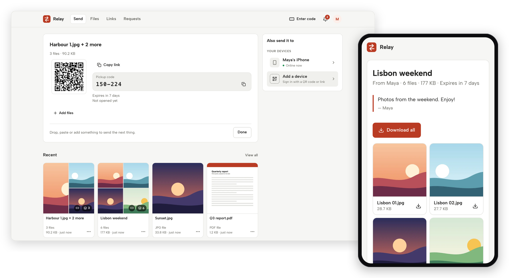
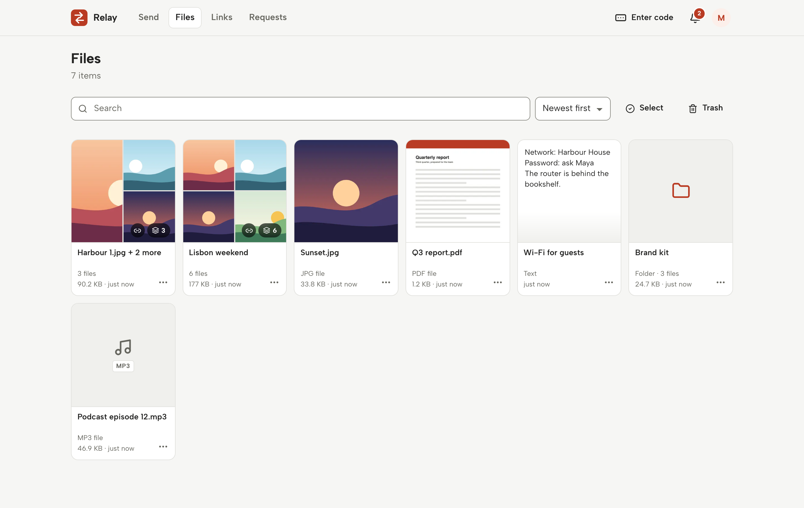
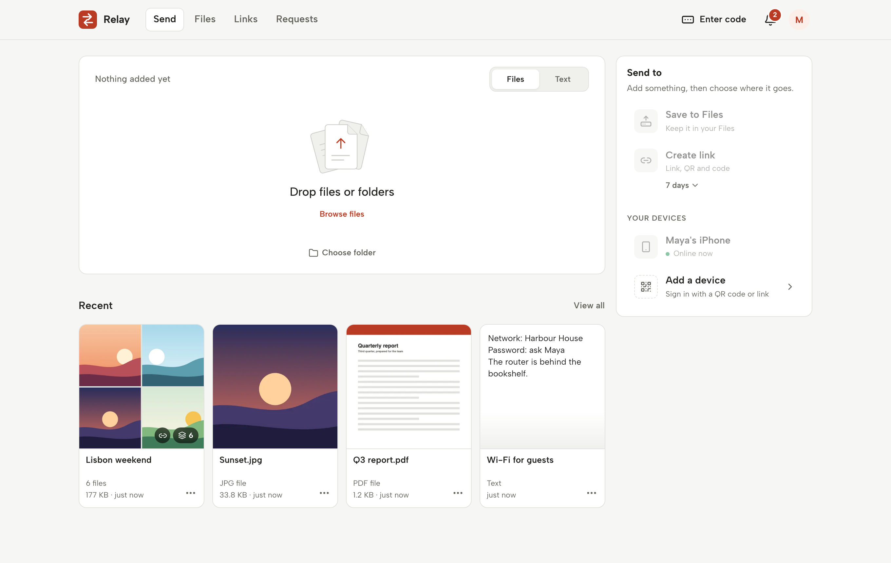

<div align="center">


# Relay

**Private file, folder and text transfers for your people, on your own server.**

Drop anything in and choose where it goes: your library, a link, or another of your devices.<br>
Resumable uploads of any size, streamed downloads, and nothing stored anywhere you don't control.

[](https://github.com/walriyami/Relay/actions/workflows/ci.yml)


[Features](#features) · [Running Relay](#running-relay) · [Hosting](docs/hosting.md) · [Architecture](docs/architecture.md) · [Development](docs/development.md)

<br>

<picture>
  <source media="(prefers-color-scheme: dark)" srcset="docs/images/hero-dark.png">
  
</picture>

</div>

## Features

<table>
<tr>
<td width="50%" valign="top">

### 📤 Send anything, decide later

Drop or paste files, whole folders and text into one draft. Nothing uploads until you pick a destination: **Save to Files**, **Create link**, or **send to one of your devices**. A copy is kept in Files, and a device that’s away gets it the next time it opens Relay.

</td>
<td width="50%" valign="top">

### ⏯️ Large files that survive

Uploads use the resumable [tus](https://tus.io) protocol, several files at a time, in chunks sized to what the connection is achieving (256 KiB to 32 MiB). A dropped network or a server restart picks up where it left off. You can pause or cancel any transfer. On the server's own network, uploads and downloads can skip the internet and go straight to Relay, where the host allows it ([off on relay.walriyami.com for now](docs/hosting.md#direct-transfers-on-your-network)).

</td>
</tr>
<tr>
<td valign="top">

### 🔗 Links with a QR code and a code

Every share gets a link, a QR code and a short numeric code. Links can expire, need a password, carry a note, and show you how many people opened and downloaded them.

</td>
<td valign="top">

### 🗂️ A library that keeps everything

Every completed upload is saved first, whether you shared it or not. Search, sort and preview images, video, audio, PDFs and text. Download any folder as a ZIP. Deleted items wait in Trash for the chosen recovery period (30 days by default), bounded by the administrator's maximum content age.

</td>
</tr>
<tr>
<td valign="top">

### 📥 Upload requests

Ask someone without an account to send you files. They open a link, drop files in, and the files land in your library, counted as your storage.

**Nearby** sends files and text straight between devices on the same network, such as your iPad and iPhone at work, without going through the server or into your library. Both devices need Relay open; nothing is kept, so save what arrives. Your own devices take it without asking; other members and guests with a Nearby code accept first.

</td>
<td valign="top">

### 🔐 Private by design

Accounts are invite-only. Sign in with a password, a passkey, or a code from a device where you're already signed in. Administrators manage accounts and limits. Their dashboard does not browse members’ files, but administrators are trusted: resetting a member’s password lets them sign in as that member.

</td>
</tr>
<tr>
<td valign="top">

### 📱 Built for every screen

Responsive from phones to desktops, with light, dark and system themes. Installs as an app, takes files from the share sheet and can notify you ([On your phone](#on-your-phone)). Keyboard-accessible, and tested in Chromium, Firefox, WebKit and a mobile viewport.

</td>
<td valign="top">

### 🧱 Simple to run

One container, one SQLite database, one data volume. Each unique file is stored once. Signing in with a Walriyami account is optional; without it, Relay needs no other service.

</td>
</tr>
</table>

## On your phone

- **Install it.** In Chrome or Edge, use **Settings → Arrivals → Install Relay** or the browser's install button. On iPhone and iPad, open Relay in Safari, tap **Share**, then **Add to Home Screen**. Relay then opens in its own window.
- **Share to Relay.** Once installed on Android or a computer, Relay appears in the share sheet. Files, text and links you share to it land in the Send draft, ready for you to choose where they go.
- **From an iPhone, with a Shortcut.** Safari doesn't let web apps join the share sheet, so a Shortcut does it for text and links: make a Shortcut that receives **Text** and **URLs** from the share sheet, add **URL** with `https://<your Relay address>/share#text=` followed by the **Shortcut Input** (encoded with **URL Encode**), then **Open URLs**. Everything after `#` stays on the phone, so the text never passes through the server before you send it. Files still go through Relay's own **Add files** button.
- **Notifications.** **Settings → Arrivals → Notifications on this device** tells you when something arrives for that device, someone sends files to one of your requests, or one of your links is downloaded for the first time, even with Relay closed. It's off until you turn it on, on each device separately, and Relay suggests it once, in the Activity bell or after something first arrives. The Activity choices in Settings decide which of these you hear about. On iPhone and iPad this works only in Relay added to the Home Screen (iOS 16.4 or later); Chrome, Edge and Firefox support it everywhere else.
- **Share and save.** On phones, links have a **Share…** button that opens the share sheet next to **Copy link**, and saving a received photo or video offers **Save Image** or **Save Video** so it goes into Photos rather than Files.

## Screenshots

<table>
<tr>
<td width="50%"><picture><source media="(prefers-color-scheme: dark)" srcset="docs/images/files-dark.png"></picture></td>
<td width="50%"><picture><source media="(prefers-color-scheme: dark)" srcset="docs/images/send-dark.png"></picture></td>
</tr>
<tr>
<td align="center"><sub><b>Files</b>: every upload, with previews, search and Trash</sub></td>
<td align="center"><sub><b>Send</b>: drop anything in, then choose where it goes</sub></td>
</tr>
</table>

## Running Relay

This copy runs at relay.walriyami.com on the owner's Raspberry Pi, deployed by Walriyami Control from a saved commit:

```sh
walctl deploy relay-production --commit main
```

[Hosting](docs/hosting.md) covers updates, settings, data and backups. To work on Relay on your own computer, see [Development](docs/development.md): `npm ci && npm run dev`, then open http://localhost:5178.

## Documentation

| Guide                                | What it covers                                                            |
| ------------------------------------ | ------------------------------------------------------------------------- |
| [Hosting](docs/hosting.md)           | How relay.walriyami.com runs: updates, settings, data, backups and limits |
| [Architecture](docs/architecture.md) | How transfers, storage, downloads and security fit together               |
| [Development](docs/development.md)   | Local setup, tests, release checks and conventions                        |
| [Reviewing Relay](docs/review.md)    | Independent product and engineering assessment                            |
| [Security policy](SECURITY.md)       | Reporting vulnerabilities and the security model                          |
| [Changelog](CHANGELOG.md)            | What changed in each release                                              |

## Built with

[React 19](https://react.dev) · [TypeScript](https://www.typescriptlang.org) · [Vite](https://vite.dev) · [Fastify](https://fastify.dev) · Node.js 24 with built-in [SQLite](https://nodejs.org/api/sqlite.html) · [tus](https://tus.io) · [zod](https://zod.dev) · [sharp](https://sharp.pixelplumbing.com) · [pdf.js](https://mozilla.github.io/pdf.js/) · [Playwright](https://playwright.dev)

## License

Copyright © 2026 walriyami. All rights reserved.

This repository has no open-source license. You may view the code on GitHub, but no permission is granted to copy, modify or distribute it. Please ask if you'd like to use it. Relay's interface font, [Albert Sans](https://github.com/usted/Albert-Sans), has its own license, the SIL Open Font License (see [`public/assets/AlbertSans-OFL.txt`](public/assets/AlbertSans-OFL.txt)).
