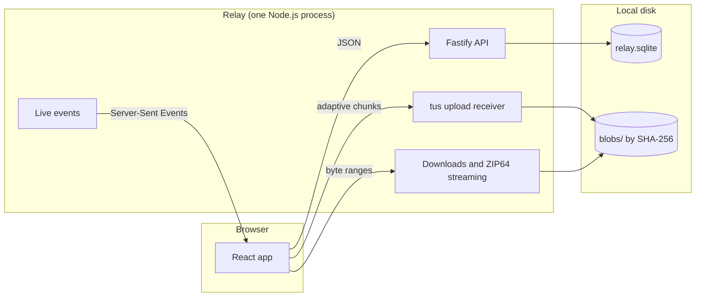

# Architecture

This guide describes the current implementation. It is not a product specification or a requirement to preserve
these choices. For independent assessment of the experience and its design, see [Reviewing Relay](review.md).

Relay is a single Node.js process that serves a React web app and a JSON API, and keeps everything on one local disk.



## Current behavior and constraints

- **Saving comes first.** Every completed upload is saved to the owner's library before anything else happens. A link or a delivery to a device only points at saved content, so it never moves or deletes the original.
- **Deliveries wait.** Sending to one of the owner's devices doesn't need Relay open there. The delivery waits until the device next opens Relay, which records that it arrived (`delivery_receipts`), and the sender's card moves from waiting to delivered, then downloaded or declined. Nothing is called sent before the device has it.
- **Honest states.** A file counts as saved only after it's flushed to disk and recorded in the database. An interrupted upload never looks saved, and Relay never claims a download reached someone's disk.
- **One process, one disk.** Relay makes no attempt at clustering. SQLite holds an exclusive lock on the data directory, so a second process fails immediately instead of corrupting data.
- **Bounded transfer buffers.** Uploads, downloads and archives stream instead of buffering whole files. Preview decoding is bounded separately: each image's decoder memory is judged from its header before decoding, one image renders at a time, and workers are replaced regularly.

## Transfers

1. The browser announces a transfer as one manifest: its files, folders and optional text. The server creates the pending item and one upload per file in a single transaction.
2. Each file uploads separately over the [tus](https://tus.io) resumable protocol in chunks, several at a time. Chunks start at 1 MiB and grow or shrink (256 KiB to 32 MiB) so each takes about 15 seconds on the connection it's using. The server hashes bytes as they arrive, so finishing even a very large file is instant.
3. When every file is in, the browser completes the transfer with a destination: **Save**, **Create link**, or **Send to a device**.

An upload is sent by the browser tab that started it. The tab holds a lease through its event stream, a short authenticated capacity probe, or its own upload requests. If the network drops or the server restarts, the tab resumes from the server's confirmed offset. Bytes that reached the server before a connection dropped are synced and counted, so a retry sends only the rest of the chunk. While it sends, the tab asks to keep the screen on, and when a phone wakes after sleeping, it restarts any upload whose connection the sleep left stuck.

When a member's tab closes, reloads, or goes quiet past its five-minute lease (a phone asleep in a pocket), its unfinished uploads are **paused**, not removed. What has arrived counts against the member's storage and stays for 24 hours (`pausedUploadMs`). The same tab simply carries on when it wakes. A new page lists the paused uploads on **Send**; choosing the same files again continues each one from the server's offset. Relay compares each chosen file's size, name, and its first and last 4 KiB already received, so a different file is never stitched onto an upload. Continuing moves the transfer to the new page, and requests from the old page are refused from then on. After 24 hours, or when the member stops it, the unfinished files are removed, while finished files and text stay in Files. A guest's upload to a request is removed as soon as its page closes, half an hour after its page goes quiet (the same half hour a guest may go without sending bytes), and 10 minutes after it was declared if by then it hasn't really begun (4 MB arrived, or any bytes of a smaller send) while the guest sent nothing else, because the guest's leftovers hold the request owner's storage and the guest cannot find them again.

Persistent event streams are capped at four per member session, two per guest grant, and four across a cooperating browser origin. A request's visitors may hold 30 in all and 8 from one network, and request visitors on the whole server 300. Admission doesn't revalidate every open stream: the 20-second check does, and admission rechecks only the few streams that would hold back the same session or browser. Overflow tabs use short probes without evicting existing streams, keeping HTTP/1 connections available for API calls and uploads; a probe starts a lease for a tab Relay hasn't seen only for a member, since a visitor's page asks only while it sends. A shared random browser ID coordinates admission but grants no access. When browser storage is unavailable, tabs use probes. Credentials are checked at most every 20 seconds; durable leases and device timestamps are batched at most once a minute (sooner for short leases). Failed connections retry with jitter and bounded backoff.

Successful authenticated member probes also keep the device available for direct delivery. This presence expires 50 seconds after the last successful probe under the default timing, allowing one missed poll; guest probes do not create member presence. Presence and delivery checks revalidate credentials, so expired, signed-out, or suspended sessions cannot remain reachable.

Every API response to a signed-in member carries a change stamp: how many changes the server had published when it began reading. The count moves with everyone's activity, so visitors and guests never see it; their views reload whenever their stream opens. A member's stream reports the same count when it opens, and it delivers every change after that. A view whose last answer is at least that recent has missed nothing, so opening the app or reconnecting reloads only the views that may have fallen behind. The account details follow the same rule. Coming back to the page loads nothing while the stream kept its 20-second beat, because it delivered every change meanwhile. A stream that went quiet while the page was hidden, as a locked phone's can, is replaced at once, and its stamp decides what to reload. Pages without a stream, such as a guest's, still reload when they come back.

## Lanes

Direct transfers and Nearby both carry their bulk bytes over lanes (`shared/lanes.ts`). A browser receiving on one WebRTC peer connection lets only a few dozen kilobytes arrive per round trip, however fast the network is, so a single connection over Wi-Fi carries a few megabits a second. Loss slows each connection separately. Several peer connections avoid both limits, which extra data channels on one connection don't.

A connection is therefore up to sixteen peer connections, each with one negotiated data channel. The first comes up through Relay; its offering side then offers the rest on it, and they're answered the same way, so signalling doesn't change. JSON control messages travel only on the first lane, which keeps them in order. Bytes travel as 64 KiB frames, each naming its stream and offset, on whichever of the other lanes has the least waiting. The first lane carries frames only while it's the only one: until the others open (at most three seconds) frames wait, on both ends, Direct's helper included, since bulk on a new connection's first lane stalls it for seconds and holds up the offer of the others behind it, and once they're open it keeps credits and offers moving. The receiver puts them back in order and credits the sender as it hands them on, so no stream runs more than its window ahead. A lane that never opens is left out. One that loses its path is taken out of use until it finds it again, and whatever it carried that wasn't credited yet goes again on the others; the receiver drops what then arrives twice. Losing the first lane ends the connection, and each protocol recovers as it would from any lost connection. A page sets up at most four peer connections at a time, since WebKit cuts off those already connected when a dozen or so find their addresses at once.

## Direct transfers

On the server's own network, a member's uploads and downloads skip the internet connection. Relay runs a helper as a child process, so a failure in its native WebRTC library can't take Relay down, and starts it again if it stops. The helper accepts WebRTC connections on one UDP port. The browser asks Relay to set a connection up: Relay passes its offer to the helper with a token for the member's session, and returns the helper's answer. The offer names the browser's addresses, usually as `.local` names, and the answer the host's private addresses. The helper checks the browser's candidates from its port and the browser checks the helper's, so the connection comes up even where the host's address can't be known or reached first, as from a container on Docker Desktop. Only local network addresses are ever checked, so the connection works only on the server's networks, and no STUN or TURN server is involved. The browser counts the connection as ready only once a check request has made the whole trip back to Relay.

Once it's ready, the browser adds the connection's other lanes. Requests share the connection, numbered in order: the request, its body once the helper is ready for it, the response head, its body, and an end. Each body is a stream on the lanes with a 16 MiB window. The helper passes it to Relay over a Unix socket in a private directory the two share, carrying the session token instead of cookies. That socket serves only the bulk routes (upload chunks, file and ZIP downloads, and the check) as the session behind the token, and refuses anything else. The protocol is in `shared/local.ts`.

- **Uploads** keep tus: only the transport changes, request by request. A chunk that fails on the direct connection is retried the usual way from the server's offset. Chunk sizes adapt to each route's measured throughput.
- **Downloads** arrive over the lanes and are handed to a service worker (`public/local-sw.js`), which serves them to a hidden frame as an ordinary download. The browser saves them to disk as they arrive, with its own progress and cancel. Back pressure runs from the disk through the worker and the page to the helper. If the connection drops, the rest comes over HTTP from the same byte, with `If-Range` ensuring it's the same file. After an upgrade, a newer worker waits until no download depends on the old one, because taking over would cut off the downloads the old one is serving.
- **Guests** never go direct. The helper acts for the session that set up the connection, so a link or request grant would not travel.

## Nearby

Nearby sends files and text from one device straight to another on the same network. Relay only introduces the two devices: the bytes never pass through it and nothing is saved to anyone's Files. The protocol between the devices is in `client/lib/nearby/protocol.ts`; what Relay relays is in `shared/nearby.ts`.

- **Presence.** A signed-in device with Relay open is present. One tab per device is its endpoint: the tab holding a Web Lock, which uses its event stream. Other tabs follow it over a `BroadcastChannel` and can take over. Guests who joined with a member's Nearby code are present while their page is open. Relay keeps presence in memory only.
- **Who can reach whom.** Relay decides this for every signal. A member's own devices can always reach each other, and they accept automatically. Two members' devices can reach each other when both members allow it (**Visible to people nearby**) and Relay sees both at the same network: the same public IPv4 address or IPv6 /64, or any of Relay's own private networks. Guests can reach the devices of the member whose code they used, and those devices can reach them. Everyone except a member's own devices must accept before anything is sent.
- **Connecting.** One endpoint sends a WebRTC offer and the other an answer, through Relay's API and event streams. Each carries all of its candidates, so signalling takes two messages. There are no STUN or TURN servers, so only local addresses are tried: where devices can't reach each other, as on guest Wi-Fi with client isolation, the connection fails instead of going anywhere else. A member's own device that can't be reached offers **Send via Relay**, which sends the same files the usual way.
- **Transfers.** The connection's lanes carry the offer, the answer and the results as JSON control messages. Each file, and the text, then travels as a stream of its own, three at a time, no more than 8 MiB ahead of what the receiver has stored. If the connection drops, the devices connect again and carry on from what the receiver already has, for up to 90 seconds.
- **Receiving and saving.** Received bytes are written to the browser's private file system as they arrive, a megabyte at a time, where it has one (Safari since 26). Otherwise they're kept in the tab's memory, up to 2 GiB on a computer and 512 MiB on a phone or tablet, finished transfers included; a transfer that wouldn't fit is declined at the start, saying why. On phones and tablets **Save** opens the share sheet, so photos can go straight to the photo library. On computers files download one at a time, or all together as one uncompressed ZIP made in the browser, whose CRC-32s a worker works out from the received files as it's made. Received files belong to the tab and are gone when it closes.

## Storage

- **Content-addressed files.** Each unique file is stored once under `blobs/`, named by its SHA-256. Several items can share the same bytes, and each owner's storage still counts their saved size.
- **Library.** Items hold a tree of folders, files and text. Items are never edited in place. They can be renamed and have files added, and nothing inside is replaced or removed.
- **Retention and Trash.** The first meaningful saved content anchors an item's age. The member's Files duration sets its initial expiry; the strictest admin maximum age also bounds renewal and Trash. Pending-only upload scaffolding has no age until first save. Trash stores a fixed purge deadline, which may shorten but never extend. Automatic Trash begins at the original expiry, not the maintenance run. Access checks deny expired content even before cleanup. Links pause while their item is in Trash and work again when it is restored, unless they expired or were turned off meanwhile. Deleting an item removes its rows at once and journals the files nothing else uses (`blob_cleanup`) in the same transaction; a background drain deletes them a few dozen at a time, syncing each directory once per batch, so a large deletion never holds up other requests. Journaled files remain durable cleanup work until payload and renditions are durably removed.
- **Running totals.** Triggers on `nodes` keep each member's stored bytes (`users.bytes_used`) and their bytes and file counts by MIME type (`stored_types`), so the Usage and Admin pages read a few rows instead of adding up every file; only Trash is counted from its items. At startup Relay compares the two and rebuilds `stored_types` from the nodes if they differ. `tests/query-plans.test.ts` fails when a library, usage or admin page reads a whole large table. Triggers on `nodes`, `uploads`, `transfers` and `items` also keep what unfinished uploads hold (`users.reserved_bytes`, `reserved_visitor_unsent`, `unsent_member`, `unsent_visitor`) and what each request holds (`requests.held_entries`, `held_bytes`), so the room checks a request-link visitor sets off, on every page view and every MiB they send, read a few rows. At startup Relay works these out again from the unfinished uploads and the requests' submissions and corrects any that differ; `tests/held-totals.test.ts` holds them to the full sums.
- **Schema.** `server/db/schema.sql` creates an empty database atomically and is the only description of the database. Startup compares an existing database with it (`server/db/schema.ts`) and, in one transaction, adds what is missing: tables, columns that can be added without rewriting rows, and indexes, triggers and views. A change that would lose or reinterpret data is refused before anything is touched. Startup also runs SQLite's `quick_check`; a damaged database stops Relay with recovery steps rather than a stack trace.

Administrators can run resumable integrity scans that hash stored files sequentially. Missing, corrupt and unreadable files remain recorded as degraded; healthy content stays available. A verified new upload can atomically repair damaged content with the same hash and invalidate stale previews. Damage is shown where it can be acted on: item summaries carry a damaged-file count, item detail flags each damaged file, the session carries the member's total, and the admin overview lists affected members with file and item counts only. Owners' open pages refresh when a check marks a file damaged or an upload repairs it.

## Downloads

- Every file download supports HTTP byte ranges.
- Folders and whole items download as uncompressed ZIP64 archives, streamed on demand. Relay computes each archive's layout from the stored sizes and checksums, so archives support exact byte ranges too, with nothing prepared or cached. There is no entry limit: headers are written as they are sent, so an archive costs a few numbers per entry (about 5 MB for 100,000) rather than a copy of its directory. Each entry's MS-DOS time is written in the time zone the browser names with `tz`, since unzip tools read it as local time, and each also carries an exact UTC timestamp (the `0x5455` extra field) for tools that read that.
- Server thumbnails cover images, including HEIC. One long-lived worker thread renders them, one image at a time: decoders' memory is outside the worker's limits, and one render at a time keeps a crafted image within the server's memory and lets an interrupted render be blamed on the image that caused it. Before anything is decoded, the image's header decides what decoding it would cost, by format and shape (`server/modules/downloads/image-limits.ts`): up to 50 MP and 65,535 pixels a side; a row of at most 128 KiB for PNG and JPEG, which are read a few rows at a time; and at most about 200 MB for decoders that hold the whole image (interlaced PNG, progressive JPEG, GIF, WebP, AVIF). That allows a 34 MP progressive JPEG with full colour detail, a 26 MP GIF or an 8.7 MP AVIF; HEIC up to 25 MP; and JPEGs of at most 100 scans. An AVIF is judged by the largest image its boxes declare, since a crop is applied only after the whole frame is decoded, and an AVIF made of tiles or layers isn't previewed. Measured in the 768 MB container, the most costly image allowed adds about 360 MB while it renders (`npm run verify:thumbnails`). An image refused by these limits, or that a decoder rejects, is marked as unpreviewable and never tried again. While an image decodes, a note on disk records it; the note survives a restart, and a render cut short by Relay stopping or by the 15-second time limit keeps it. That limit starts once the worker and decoder are loaded; a worker slow to get there has a limit of its own that isn't held against the image. An image cut short twice in a row isn't tried again, so a file that brings Relay down, or one that would occupy the renderer for 15 seconds on every look, costs at most two attempts. A worker is stopped after 30 idle seconds, after 200 renders, or after a HEIF photo, whose decoder keeps its memory. Requests wait their turn, taken in rotation between the people asking; past 128 waiting for one person, the server answers 503 with `Retry-After`, and the page asks again a few times before it shows a file icon. PDFs are rendered in the browser with pdf.js from byte ranges, so they preview on phones that can't show PDFs inline.

## Accounts and access

- Accounts are created by invitation only. The first account is created in the browser during setup: whoever finishes that step first becomes the administrator, and setup then closes for good.
- People sign in with a password (hashed with scrypt), a passkey (WebAuthn), or a one-time code shown on another of their signed-in devices.
- Sessions use `HttpOnly`, `SameSite` cookies (`__Host-` prefixed over HTTPS). Every unsafe request must come from the address it was sent to (exactly `RELAY_ORIGIN`, when set) and carry a CSRF token.
- Link, request and invitation tokens are derived from their ids with an HMAC key (`RELAY_SECRET`). The database stores only hashes of those tokens.
- Six-digit codes work for a day after they're issued and are reissued when the owner looks at that recipient. Wrong codes are limited per address and per network, more tightly while many are coming in, and to a fixed number a day from everywhere, after which code entry pauses for visitors who aren't signed in (`server/lib/pickup-code-guard.ts`). Wrong codes and passwords are counted in the `failures` table (`server/lib/failures.ts`), so a restart forgives nobody; rows older than a day are removed. Every code that doesn't open something gets the same answer, whether it never existed or has ended. An ended code's digits stay reserved for 30 days before another recipient may get them.
- Every content and archive route checks authorization. Administrators manage accounts and limits, see how much each member stores and moves, and read a 90-day history of account events, sends and shares, failed sign-ins and errors, but they can't read members' files or links. The history keeps sizes and counts, never file names or link addresses. Relay keeps at least one administrator. Whoever runs the server can recover an administrator's password with `RELAY_RECOVER_ADMIN`, which writes a one-time link to the log.

Relay isn't end-to-end encrypted. Whoever operates the server can read what's stored on it.

## Installed app and notifications

- **Service worker.** `public/sw.js` caches the app shell (`index.html`, the hashed files it names, icons and fonts) so an installed Relay opens quickly, and replaces it when a new build is deployed. It never answers `/api/`, `/uploads/` or `/local/`, and never stores responses from them.
- **Share target.** `public/manifest.webmanifest` declares a share target that posts to `/share`. The worker takes that post, keeps the files and text in the browser's IndexedDB and opens `/share?id=…`. That page (`client/features/send/ShareIntake.tsx`, with `client/lib/pwa-share.ts`) shows "Something was shared to Relay" with what arrived, and moves it into the Send draft only when the member taps **Add to Send**; **Discard** deletes it. Nothing in the post reliably tells the share sheet apart from a website auto-submitting the same form (the referrer can be stripped), so arrival is made explicit instead. Without the worker, the server's `/share` (`server/modules/push/share-target.ts`) discards the upload and opens the same page with an error. `/share#text=…` (the iPhone Shortcut) brings text the same way, without a request carrying it, and gets the same Add or Discard screen.
- **Web Push.** `server/modules/push` sends notifications itself, with no library: VAPID (ES256) signatures and `aes128gcm` encryption from `node:crypto`. Subscriptions belong to one device's session in `push_subscriptions`; a trigger deletes them with the device's last session. Activity events (`server/modules/activity`) call the push module after their transaction commits, for arrivals on a device, request uploads and a link's first download, honoring the member's Activity choices. Delivery happens in the background; a 404 or 410 from the push service deletes the subscription.

## Project layout

```text
client/            React app
  app/             Shell, routing, session, public pages
  components/      Shared UI components
  features/        One folder per area: send, nearby, library, links, requests, incoming, settings, admin…
  lib/             Transfers engine, Nearby connections, live connection, formatting, previews
  styles/          Design tokens and CSS
local/             Direct-transfer helper, run by Relay (WebRTC to Relay's local socket)
server/
  app.ts           Fastify setup, security headers, rate limits, route wiring
  config.ts        Environment configuration
  db/              SQLite connection and schema
  modules/         One folder per domain: auth, transfers, library, links, downloads, admin…
  storage/         Content-addressed blob store and file helpers
shared/            Typed API contract (zod) and models used by both sides
scripts/           Screenshots and release verification
tests/             Backend integration tests (node:test)
tests/browser/     End-to-end journeys (Playwright)
```

The API contract lives in `shared/api.ts`. Each endpoint declares its method, path, auth level and zod schema once. The server validates requests against it, and the client and tests call endpoints through it with full types.
